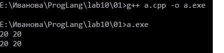
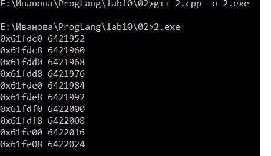
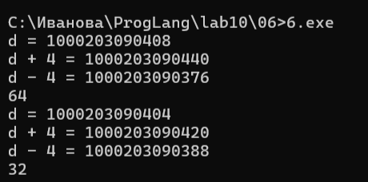
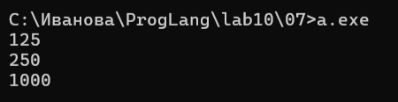
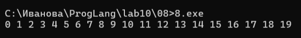
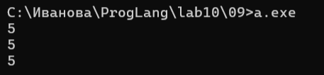
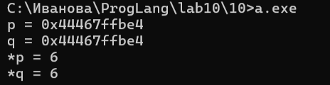

# Языки программирования
## Лабораторная работа 10

### Задание 1 **(2)**

*Рассмотрите следующие фрагменты программ. Запишите, что означают символы* **&** и  * *в каждом случае применения.*
```
int a = 10, b = 20;
int *p = &a , *q = &b;
p = q;
std::cout << *p <<' '<< *q << std::endl;
```
```
int a = 10, b = 20;
int *p = &a , *q = &b;
*p = *q;
std::cout << *p <<' '<< *q << std::endl;
```
*Чем различаются присваивания в третьей строке? Что можно вывести,
чтобы показать различия?*

*Примеры программ сохраните в папке с номером задания. Скриншоты работы прикрепите к отчету.*

* При объявлении int *p звёздочка означает, что p — это указатель, то есть переменная для хранения адреса.
* В выражениях *p звёздочка — это операция разыменования. Получение значения по хранимому адресу.
* Символ & перед переменной в выражении &a — это операция взятия адреса в памяти.
* В выражении p = q копируется адрес, указатель p начинает указывать на b.
* В выражении *p = *q копируется значение, значение а становится = 20.



### Задание 2 **(1)**

*Рассмотрим следующую программу.* 
```
double x[10];
for (int i = 0; i <10; i++)
    std::cout << &x[i] << std::endl;
```
*Что она выводит? Измените
вывод так, чтобы адреса выводились в десятичной системе счисления.
Объясните почему числа составляют арифметическую прогрессию с
определенным шагом.*

*Записанную программу сохраните в папке с номером задания.*
*Скриншоты работы прикрепите к отчету.*

* Программа выводит адреса всех десяти элементов массива х. Оператор & использует для получения адреса элемента массива.
* Адреса элементов образуют арифметическую прогрессию, потому что элементы массива располагаются в памяти последовательно. Каждый элемент типа double занимает 8 байт, поэтому разница между адресами соседних элементов = 8.



### Задание 3 **(2)**

*Токен* **«*»** *в языке C++ может использоваться в трех различных
случаях. Аналогично токен* **«&»** *также может использоваться в трех
случаях. Приведите пример одной программы в которой они были бы
использованы во всех случаях.*

*Записанную программу сохраните в папке с номером задания.*

### Задание 4 **(2)**

*Выпишите значения всех переменных, в том числе указателей,
после выполнения каждой инструкции программы. Объясните, что
происходит в результате выполнения каждой инструкции.*
```
unsigned a = 8, b = 3 ,c = 17;
unsigned *p = &a;
unsigned *q = &b;
*p += *q + c;
c = *q;
p = &c;
c += a;
*p += 10;
*q = *p;
q = p ;
*q += 10;
```

* ```nsigned a = 8, b = 3 ,c = 17;``` - создаем три переменные.
* ```unsigned *p = &a;``` - создаем указатель p, который хранит адрес переменной a.
* ```unsigned *q = &b;``` - создаем указатель q, который хранит адрес переменной b.
* ```*p += *q + c;``` - расшифровываем: *p = 8, *q = 3, c = 17. Получается a = 8+3+17 = 28.
* ```c = *q;``` - *p это значение переменной b, равное 3.
* ```p = &c;``` - Теперь указатель p начинает хранить адрес переменной c, а не a.
* ```c += a;``` - Прибавляем к с значение а. с = 3+28 = 31.
* ```*p += 10;``` - Теперь p указывает на с, поэтому *p это значение с. с = 31+10 = 41.
* ```*q = *p;``` - *q это значение b, *p - c. Присваиваем с переменной b. 
* ```q = p;``` - q копирует адрес из p.
* ```*q += 10;``` - тк q указывает на с, прибавляем 10 к знач с. с = 51
* Итоговые значения: a=28, b= 41, c=51, p указывает на c, q указывает на c.

### Задание 5 **(1)**

*Что сравнивается в приведенной ниже программе? Как можно
изменить первую строчку программы, чтобы результат тоже
изменился?*
```
int x = 1, y = 2;
int *p = &y, *q = &x;
if (p < q)
    std::cout << "Yes";
else
    std::cout << "No";
```
* Сравниваются адреса, которые хранятся в указателях p и q.
* Меняем x и y местами. С x = 1 на y = 1, с y = 2 на x = 2.

### Задание 6 **(2)**

*Объясните работу следующей программы. Как изменится
результат, если тип* **double** *изменить на некоторый другой, например*
**int** *или* **char**?
```
double x = 0;
double *d = &x;
std::cout << reinterpret_cast<size_t>(d + 4) - reinterpret_cast<size_t>(d - 4) << std::endl;
```
* При прибавлении или вычитании числа к указателю происходит перемещение на указанное количество элементов этого типа.
* На фото вывод с double и int.


### Задание 7 **(2)**

*Объясните работу следующей программы. Как изменится
результат, если тип* **double** *изменить на некоторый другой, например*
**int** *или* **char**?
```
std::cout << reinterpret_cast <double*>(3000) - reinterpret_cast <double*>(2000) << std::endl;
```
* В программе два адреса 3000 и 2000, приводим их к типу double*. При вычитании двух указателей одного типа С++ автоматически делит разницу в байтах на размер одного элемента, чтобы показать, сколько элементов этого типа помещается между этими адресами.
* На фото вывод с double, char и int.


### Задание 8 **(2)**

*Что надо дописать в записанной ниже программе вместо многоточий, чтобы
она выводила все числа из массива* **a**? *Почему?*
```
int a[20];
for ( int i = 0; i < 20; i++)
    a[i] = i;
int *b=a + 8;
for (int i =...; i <...; i++)
    std::cout << b[i] <<' ';
```
* Вместо многоточий записать int i = -8; i < 12.
* 

### Задание 9 **(2)**

*Что выводит следующая программа? Изменится ли результат если
изменить тип элементов массива?*

```
int a[10];
std::cout << &a[8] - &a[3] << std::endl;
```
* Программа выводит разность адресов 8 и 3 элементов. Результат равен: 8 - 3 = 5.
* При изменении типа элементов массива результат не изменится.

  
### Задание 10 **(1)**

*Есть ли разница между инициализацией* **p** и **q** *в следующей программе? Обоснуйте ответ.*
```
int x [10]={1, 2, 3, 4, 5, 6, 7, 8, 9, 10};
int *p = x + 5;
int *q = &x[5];
```
* Разницы между инициализацией указателей p и q нет. В первом случае x + 5 означает смещение от начала массива на пять элементов. Во втором случае &x[5] сразу получает адрес шестого элемента массива.
* Обе записи обозначают один и тот же адрес, поэтому указатели p и q указывают на один элемент массива.


### Задание 11 **(3)**

*Указатели можно использовать для итерации по массивам.
Напишите программу, которая найдет сумму элементов массива,
используя указатели. В начале цикла указатель требуется установить
на начало массива, в конце каждой итерации смещать его к
следующему элементу массива через инкремент. Для выхода из цикла
надо проверять, что указатель дошел до конца массива.*
```
int x [10]={1, 2, 3, 4, 5, 6, 7, 8, 9, 10};
int s = 0;
for (int *p = ...; ...; ...)
    s += ...
std::cout << s;
```

*Записанную программу сохраните в папке с номером задания.*

